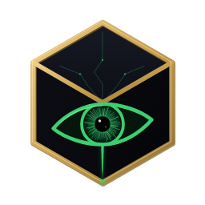
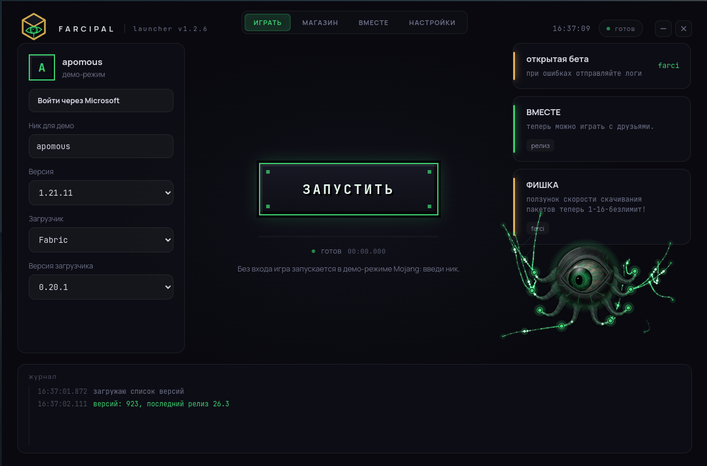
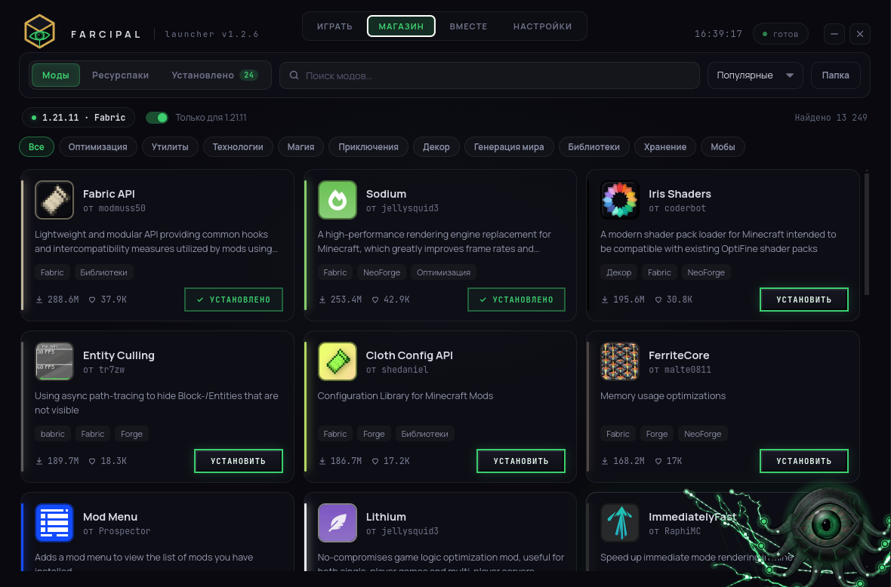
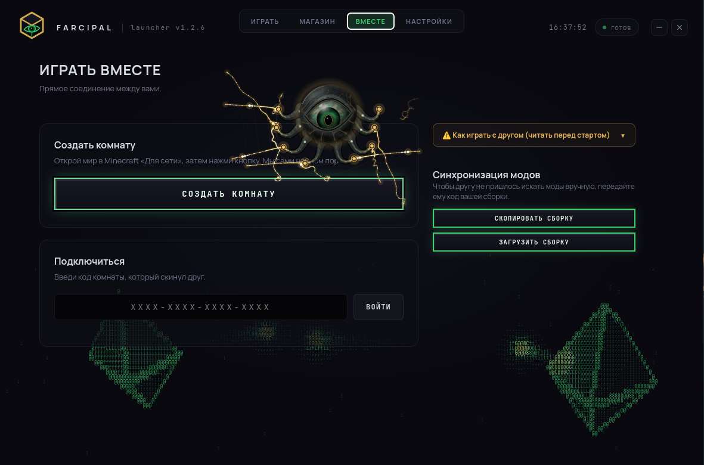
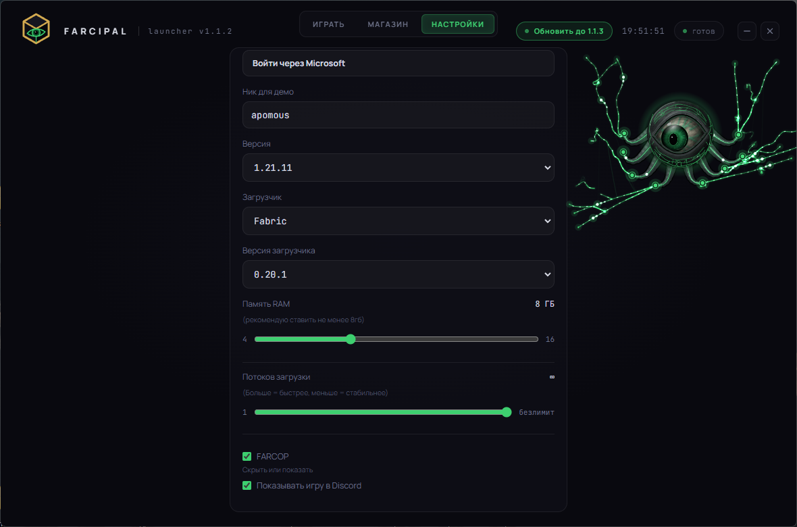

<div align="center">



# F A R C I P A L

### Лаунчер Minecraft Java, который смотрит на тебя

Vanilla · Fabric · Forge · Магазин модов · Игра с друзьями · Автообновления

<br>

[](https://github.com/apomous/farcipal-launcher/releases/latest)
[](https://github.com/apomous/farcipal-launcher/releases)
[](LICENSE)
[](https://github.com/apomous/farcipal-launcher/issues)


[](https://github.com/apomous/farcipal-launcher/issues)
[](https://github.com/apomous/farcipal-launcher/commits)

<br>

[**⬇ Скачать**](https://github.com/apomous/farcipal-launcher/releases/latest) · [Возможности](#возможности) · [Установка](#установка) · [Играть вместе](#играть-вместе) · [Сборка](#сборка-из-исходников) · [FAQ](#faq)

<br>



</div>

> [!NOTE]
> **Открытая бета.** Лаунчер уже играет, но мы ещё шлифуем. Нашёл баг? Открой [issue](https://github.com/apomous/farcipal-launcher/issues) и приложи файл `launcher-last.log` (где он лежит, см. [FAQ](#faq)).

## Возможности

| | |
| --- | --- |
| **Vanilla, Fabric, Forge** | Выбираешь версию игры и загрузчик, остальное лаунчер ставит сам: игру, библиотеки, ассеты, профиль загрузчика. Forge с 1.12, Fabric для всех стабильных версий. |
| **Windows и Linux** | Один и тот же лаунчер на обеих системах: установщик для Windows, AppImage и deb для Linux. Java лаунчер скачивает сам на любой из них. |
| **Играть вместе** | Создай комнату, отправь другу код и играйте по сети без белого IP и проброса портов. Код сборки синхронизирует моды у друга одним действием. |
| **Магазин модов и ресурспаков** | Каталог [Modrinth](https://modrinth.com) внутри лаунчера: поиск, категории, сортировка, фильтр «только для твоей версии», установка в один клик. Обязательные зависимости (например, Fabric API) ставятся сами. |
| **Отдельный профиль на каждую сборку** | Моды для 1.20.1 и 1.21 не смешиваются: у каждой пары «версия + загрузчик» своя папка `instances/<версия>-<загрузчик>`. Ванильные миры остаются на месте. |
| **Автопочинка файлов** | Сверяет SHA1-хеши игры и ассетов. Если файл скачался битым (например, из-за обрыва VPN), лаунчер незаметно перекачает только его. |
| **Безлимитные потоки** | Ползунок в настройках от 1 до «∞». Лаунчер откроет до 64 соединений, чтобы выжать максимум из твоего интернета. |
| **Мгновенная отмена** | Кнопка «Остановить» обрывает все сетевые запросы (игра, Java, моды) и завершает процессы Java за миллисекунды. |
| **Вход через Microsoft** | Обычный аккаунт Minecraft. Без входа игра запускается в демо-режиме Mojang. |
| **Статус в Discord** | «Playing Minecraft 1.21.4 · Farcipal» с версией, загрузчиком и таймером. Включается и выключается в настройках. |
| **Автообновления** | Лаунчер сам находит новую версию в GitHub Releases, качает в фоне и ставит при закрытии. Если игра запущена, подождёт. |
| **Живой интерфейс** | Глаз-компаньон следит за курсором, цепляется нитями за панели и кнопки, при запуске врезается в «Запустить». А на экране загрузки и на вкладке «Вместе» два ASCII-кристалла перестреливаются файрболами. Всё это можно выключить в настройках. |
| **Мелочи** | Память под игру, автозаход на сервер, остановка на любом этапе, журнал запуска, новости в боковой панели. Шрифты лежат внутри, интернет для оформления не нужен. |

<div align="center">
<table>
  <tr>
    <td></td>
    <td></td>
  </tr>
  <tr>
    <td align="center"><sub>Магазин: Modrinth прямо в лаунчере</sub></td>
    <td align="center"><sub>Вместе: комнаты по коду</sub></td>
  </tr>
  <tr>
    <td colspan="2" align="center"><br><sub>Настройки: загрузчик, память, потоки</sub></td>
  </tr>
</table>
</div>

## Установка

Откройте [Releases](https://github.com/apomous/farcipal-launcher/releases/latest) и скачайте файл под свою систему.

### Windows

1. Скачай `Farcipal_Setup_<версия>.exe` и запусти. Права администратора не нужны: лаунчер ставится в `%LOCALAPPDATA%\Programs\Farcipal`.
2. Если Windows пишет «неизвестный издатель», нажми **Подробнее → Выполнить в любом случае**. Установщик пока без цифровой подписи, подпись в процессе получения.

### Linux

**AppImage** (подходит для Fedora, Arch, openSUSE и других, обновляется сам):

```bash
chmod +x Farcipal-*.AppImage
./Farcipal-*.AppImage
```

Если AppImage не запускается и пишет про FUSE, поставь библиотеку: на Fedora `sudo dnf install fuse-libs`, на Ubuntu `sudo apt install libfuse2`.

**deb** (Debian, Ubuntu, Mint):

```bash
sudo apt install ./farcipal-launcher_<версия>_amd64.deb
```

Пакета **rpm** в релизах нет, но его можно собрать самому, см. [Сборка из исходников](#сборка-из-исходников).

### Java

Устанавливать Java вручную **не нужно**. При первом запуске лаунчер сам скачает нужную версию (8, 17, 21 или 25) с серверов Mojang или Adoptium. Если у тебя уже стоит подходящая Java, он использует её.

| Версия игры | Java |
| --- | --- |
| 1.18 – 1.20.4 | 17+ |
| 1.20.5 – 1.21.x | 21+ |
| 26.x и новее | 25+ |

Дальше войди через Microsoft (или запускай демо), выбери версию и нажми **«Запустить»**.

## Как пользоваться

- **Играть.** Версия, загрузчик и его версия слева, кнопка в центре. Первый запуск каждой версии скачивает файлы, дальше всё мгновенно.
- **Магазин.** Выбери «Моды» или «Ресурспаки», найди нужное и нажми «Установить». Установка идёт в профиль, выбранный на вкладке «Играть». Для модов нужен Fabric или Forge. Кнопка «Папка» открывает папку профиля, туда можно класть свои файлы.
- **Вместе.** Игра по сети с друзьями, подробности ниже.
- **Настройки.** Аккаунт, версия и загрузчик, память, потоки загрузки, статус в Discord, глаз-компаньон.

## Играть вместе

Вкладка **«Вместе»** соединяет вас напрямую, без белого IP и настройки роутера.

**Хозяин мира**
1. Запусти игру и открой свой мир для сети в Minecraft («Открыть для сети»).
2. В лаунчере нажми **«Создать комнату»**. Лаунчер сам найдёт порт и покажет код вида `XXXX-XXXX-XXXX-XXXX`.
3. Отправь код другу.

**Друг**
1. Введи код в поле «Подключиться» и нажми **«Войти»**.
2. Подключись к миру из Minecraft.

**Синхронизация модов.** Чтобы другу не пришлось искать моды вручную, нажми «Скопировать сборку» и отправь ему полученный код. Друг вставляет его через «Загрузить сборку» и получает ту же сборку. Версия игры и загрузчик у вас должны совпадать.

> [!TIP]
> Не отправляй код комнаты посторонним: он даёт доступ к вашему миру.

## Discord

Чтобы друзья видели, во что ты играешь, ничего настраивать не нужно: включено по умолчанию, выключается в настройках. Название сервера показывается, адрес нет.

Если собираешь свою сборку, создай приложение на [discord.com/developers](https://discord.com/developers/applications), назови его «Farcipal», скопируй Application ID в `config.js` (`discordClientId`) и загрузи иконку в Rich Presence → Art Assets с ключом `farcipal`.

## Сборка из исходников

Нужны Node.js 22+ и pnpm.

```bash
git clone https://github.com/apomous/farcipal-launcher
cd farcipal-launcher
pnpm install
pnpm start            # запуск в режиме разработки
pnpm dist             # Windows: установщик в dist/Farcipal_Setup_<версия>.exe
pnpm dist:linux       # Linux: AppImage, deb и rpm в dist/
```

<details>
<summary><b>Подробности для Linux</b></summary>

<br>

Для нативного модуля `lzma-native` нужны инструменты сборки. На Fedora:

```bash
sudo dnf install gcc-c++ make python3 rpm-build
```

На Ubuntu и Debian: `sudo apt install build-essential python3 rpm`.

`rpm-build` (или пакет `rpm` в Ubuntu) нужен только для сборки `.rpm`. Если он не нужен, собери только AppImage и deb:

```bash
pnpm exec electron-builder --linux AppImage deb
```

</details>

В `.npmrc` должно быть `node-linker=hoisted`: без него `electron-builder` с pnpm теряет модули. Если `npm install` падает с `EUNSUPPORTEDPROTOCOL workspace:`, используй pnpm: часть пакетов `@xmcl` публикуется с этим протоколом.

**Выпуск релиза.** Подними версию в `package.json`, затем:

```bash
git tag v0.1.1 && git push origin v0.1.1
```

GitHub Actions соберёт Windows-установщик, а потом AppImage и deb для Linux и положит всё в **черновик** релиза вместе с `latest.yml` и `latest-linux.yml` (по ним работает автообновление). Проверь файлы и нажми Publish, только после этого пользователи получат обновление. Тег и версия в `package.json` должны совпадать.

## Структура проекта

```
main.js          окно, IPC, вход через Microsoft, запуск игры
game.js          установка и запуск: ваниль → загрузчик → зависимости → игра (@xmcl), автоустановка Java
assets.js        загрузка и проверка ассетов (повторы, хеши, отмена)
network.js       общий HTTP-клиент (undici)
loaders.js       списки версий Fabric и Forge, профили
modrinth.js      магазин: поиск, установка, зависимости, удаление
discord.js       статус в Discord (локальный IPC)
updater.js       автообновления (electron-updater)
platform.js      различия Windows и Linux в одном месте
preload.js       безопасный мост между окном и main.js
config.js        сервер для автозахода, новости, discordClientId
vendor/easytier  сетевое ядро для вкладки «Вместе»
renderer/        интерфейс: app.js, store.js, update.js, стили, шрифты,
                 companion.js (глаз и нити), ascii-bg.js и ascii-worker.js (кристаллы)
build/           иконки и текст лицензии для установщиков
scripts/         служебные скрипты сборки
```

## Данные и приватность

| | Windows | Linux |
| --- | --- | --- |
| Игра, библиотеки, профили, моды | `%APPDATA%\.farcipal` | `~/.farcipal` |
| Журнал последнего запуска | `%APPDATA%\.farcipal\launcher-last.log` | `~/.farcipal/launcher-last.log` |
| Настройки и сессия Microsoft | `%APPDATA%\Farcipal` | `~/.config/Farcipal` |

- Токен Microsoft хранится только на твоём компьютере и шифруется через `safeStorage` Electron: на Windows это DPAPI, на Linux системная связка ключей (KWallet или GNOME Keyring), если она доступна.
- Файлы качаются только с серверов Mojang, Adoptium, Fabric, Forge и Modrinth. Игра, ассеты, моды и ресурспаки проверяются по контрольной сумме.
- Вкладка «Вместе» подключается к публичным узлам EasyTier, чтобы вы нашли друг друга. Если прямое соединение невозможно, трафик может идти через них.
- Лаунчер не собирает аналитику. Статус в Discord можно отключить.
- Удаление лаунчера не трогает папку `.farcipal`: миры и моды остаются.

## FAQ

<details>
<summary><b>Нужен ли купленный Minecraft?</b></summary>

Для полной игры да: войди аккаунтом, который её купил. Без аккаунта работает демо-режим Mojang (ограничение накладывает сам клиент).

</details>

<details>
<summary><b>Игра не запускается, что присылать?</b></summary>

Файл `launcher-last.log` (пути в таблице [Данные и приватность](#данные-и-приватность)). В нём полный журнал последнего запуска.

</details>

<details>
<summary><b>Мод не работает или игра падает</b></summary>

Проверь, что версия игры и загрузчик в профиле совпадают с модом, а зависимости на месте (магазин ставит обязательные сам). Моды из магазина лежат в `instances/<версия>-<загрузчик>/mods`.

</details>

<details>
<summary><b>Я переключился с ванили на Fabric, где мои миры?</b></summary>

У Forge и Fabric свой профиль со своими мирами и настройками. Ванильные миры лежат в папке `saves` внутри `.farcipal` и никуда не делись.

</details>

<details>
<summary><b>Какой объём памяти ставить?</b></summary>

Для ванили и лёгких сборок хватает 4–6 ГБ. Для больших сборок на 100+ модов 8 ГБ. Больше ставить не стоит: на ноутбуках и слабых ПК это замедляет игру, а не ускоряет.

</details>

<details>
<summary><b>AppImage не запускается на Linux</b></summary>

Проверь, что у файла есть право на запуск (`chmod +x`) и что установлена библиотека FUSE (`fuse-libs` на Fedora, `libfuse2` на Ubuntu). Если не помогло, запусти из терминала и пришли вывод в issue.

</details>

<details>
<summary><b>Есть ли версия для macOS?</b></summary>

Пока нет. Основа на Electron кроссплатформенная, но сборки и проверки только под Windows и Linux.

</details>

## Планы

- [x] Автоустановка Java нужной версии
- [x] Шифрование токена Microsoft
- [x] Автопочинка битых файлов
- [x] Ползунок потоков загрузки 1–16–∞
- [x] Мгновенная отмена загрузки
- [x] Игра по сети через вкладку «Вместе»
- [x] Сборки для Linux (AppImage, deb)
- [ ] Обновление и отключение модов, не только установка
- [ ] NeoForge и Quilt
- [ ] Шейдеры в магазине
- [ ] Цифровая подпись установщика
- [ ] Пакет rpm в релизах

## Юридическое

Farcipal Launcher: неофициальный сторонний лаунчер. Он не связан с Mojang Studios, Microsoft или Discord и не одобрен ими. «Minecraft» является товарным знаком Mojang Synergies AB. Моды и ресурспаки предоставляют сторонние авторы через Modrinth, действуют их лицензии.

## Лицензия

[MIT](LICENSE). Использованы: [Electron](https://www.electronjs.org), [@xmcl/core и @xmcl/installer](https://github.com/Voxelum/minecraft-launcher-core-node), [msmc](https://github.com/Hanro50/MSMC), [undici](https://github.com/nodejs/undici), [EasyTier](https://github.com/EasyTier/EasyTier), [Modrinth API](https://docs.modrinth.com).

<div align="center">
<br>
<sub>Сделано с глазом, который смотрит на тебя.</sub>
</div>
