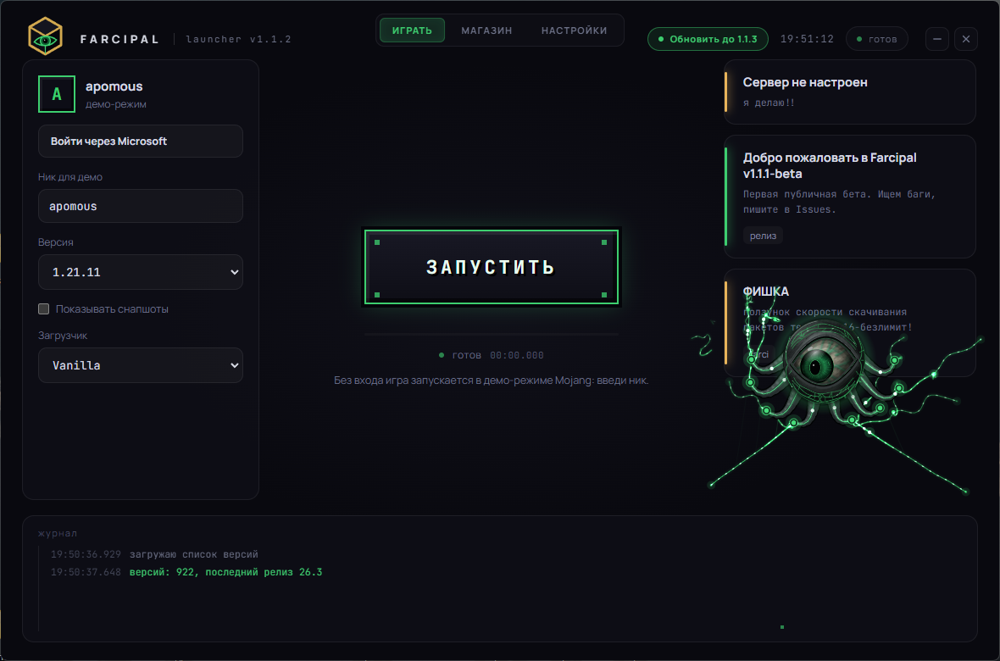
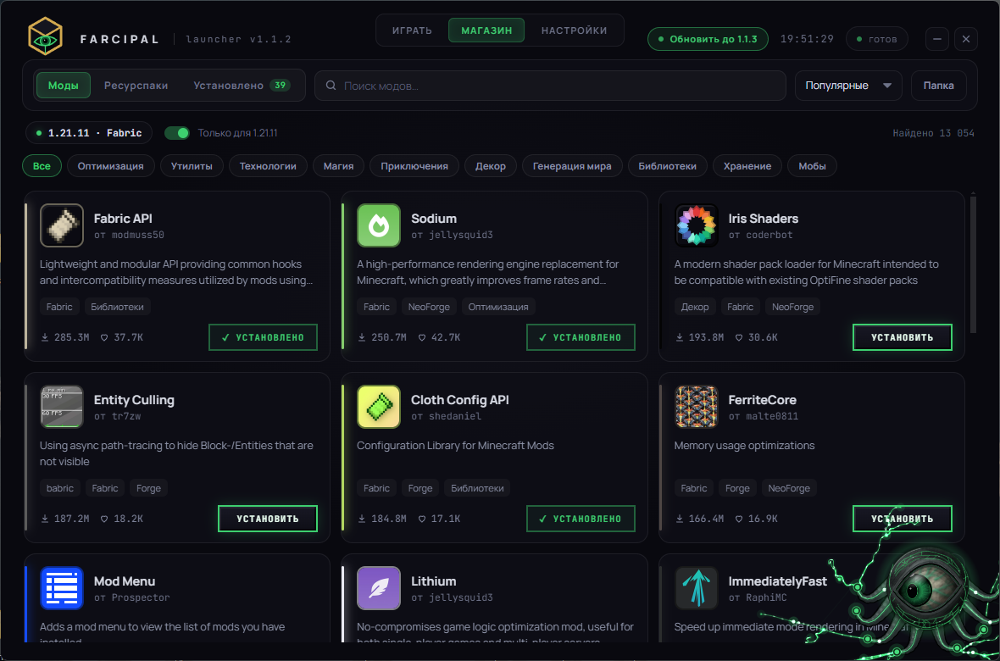
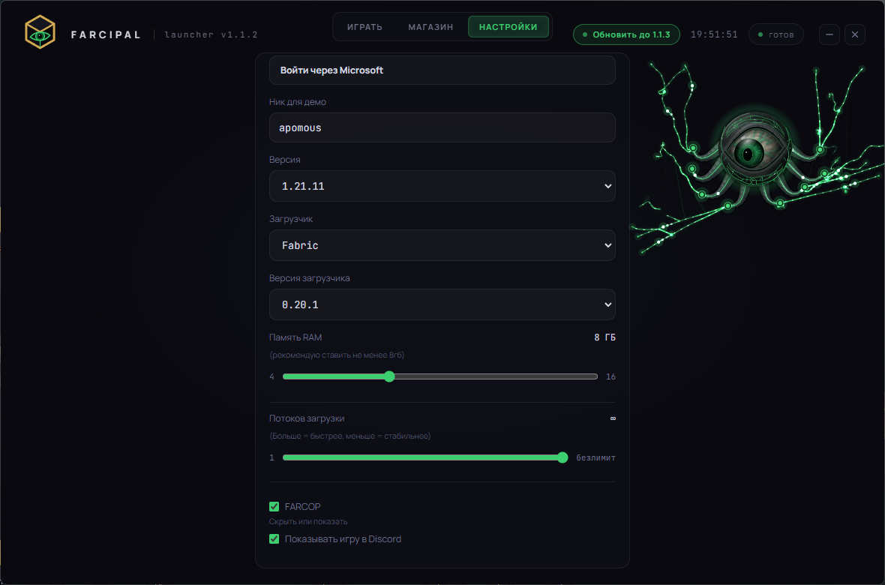

<div align="center">


# Farcipal Launcher

**Лаунчер Minecraft Java, который смотрит на тебя.**
Vanilla, Fabric и Forge. Магазин модов. Статус в Discord. Автообновления.


[](https://github.com/apomous/farcipal-launcher/releases/latest)
[](https://github.com/apomous/farcipal-launcher/releases)
[](LICENSE)


[**Скачать**](https://github.com/apomous/farcipal-launcher/releases/latest) · [Возможности](#возможности) · [Установка](#установка) · [Сборка из исходников](#сборка-из-исходников) · [FAQ](#faq)



</div>

> **Статус: открытая бета.** Лаунчер уже играет, но мы ещё шлифуем. Нашёл баг, открой [issue](https://github.com/apomous/farcipal-launcher/issues) и приложи файл `launcher-last.log` (см. [FAQ](#faq)).

## Возможности

| | |
| --- | --- |
| **Vanilla, Fabric, Forge** | Выбираешь версию игры и загрузчик, остальное лаунчер ставит сам: игру, библиотеки, ассеты, профиль загрузчика. Forge с 1.12, Fabric для всех стабильных версий. |
| **Автопочинка файлов** | Сверяет SHA1-хеши игры и ассетов. Если файл скачался битым (например, из-за обрыва VPN), лаунчер незаметно перекачает только его, не трогая остальное. |
| **Безлимитные потоки** | Ползунок в настройках можно выкрутить до «∞». Лаунчер откроет до 64 соединений, чтобы выжать максимум скорости из твоего интернета. |
| **Мгновенная отмена** | Кнопка «Остановить» обрывает все сетевые запросы (скачивание игры, Java, модов) и убивает процессы Java за миллисекунды. |
| **Магазин модов и ресурспаков** | Каталог [Modrinth](https://modrinth.com) прямо в лаунчере: поиск, категории, установка в один клик. Обязательные зависимости (например, Fabric API) ставятся сами. |
| **Отдельный профиль на каждую сборку** | Моды для 1.20.1 и 1.21 не смешиваются: у каждой пары «версия + загрузчик» своя папка `instances/<версия>-<загрузчик>`. Ванильные миры остались на месте. |
| **Вход через Microsoft** | Обычный аккаунт Minecraft. Без входа игра запускается в демо-режиме Mojang. |
| **Статус в Discord** | «Playing Minecraft 1.21.4 • Farcipal» с версией, загрузчиком и таймером. Включается и выключается в настройках. |
| **Автообновления** | Лаунчер сам находит новую версию в GitHub Releases, качает в фоне и ставит при закрытии. |
| **Живой интерфейс** | Глаз-компаньон следит за курсором, цепляется нитями за панели и кнопки, при запуске врезается в «Запустить». Можно выключить в настройках. |
| **Мелочи** | Память под игру, автозаход на свой сервер, остановка запуска на любом этапе, журнал запуска, шрифты лежат внутри (интернет не нужен для оформления). |

<div align="center">


</div>

## Установка

1. Открой [Releases](https://github.com/apomous/farcipal-launcher/releases/latest) и скачай `Farcipal_Setup_<версия>.exe`.
2. Запусти. Права администратора не нужны: лаунчер ставится в `%LOCALAPPDATA%\Programs\Farcipal`.
3. Если Windows пишет «неизвестный издатель», нажми **Подробнее → Выполнить в любом случае**. Установщик пока без цифровой подписи, подпись в процессе получения.
4. Лаунчер **сам скачает нужную версию Java** (8, 17, 21 или 25) с серверов Mojang или Adoptium при первом запуске. Устанавливать Java вручную не нужно. 
   *(Если у тебя уже стоит Java, лаунчер проверит её версию и использует, если она подходит).*

   | Версия игры | Java |
   | --- | --- |
   | 1.18 – 1.20.4 | 17+ |
   | 1.20.5 – 1.21.x | 21+ |
   | 26.x и новее | 25+ |

5. Войди через Microsoft (или запускай демо), выбери версию, нажми **«Запустить»**.

Обновления приходят сами: в шапке появится кнопка «Обновить до …». Если игра запущена, лаунчер подождёт.

## Как пользоваться

- **Играть.** Версия, загрузчик и его версия слева, кнопка в центре. Первый запуск каждой версии скачивает файлы, дальше всё мгновенно.
- **Магазин.** Вкладка «Магазин», выбери «Моды» или «Ресурспаки». Установка идёт в профиль, который выбран на вкладке «Играть». Для модов нужен Fabric или Forge. Удаление в два клика. Кнопка «Папка» открывает папку профиля, туда можно класть свои файлы.
- **Настройки.** Аккаунт, память, показ статуса в Discord, глаз-компаньон.

## Discord

Чтобы друзья видели, во что ты играешь, ничего настраивать не нужно: включено по умолчанию, выключается в настройках. Название сервера показывается, адрес нет.

Если собираешь свою сборку, создай приложение на [discord.com/developers](https://discord.com/developers/applications), назови его «Farcipal», скопируй Application ID в `config.js` (`discordClientId`) и загрузи иконку в Rich Presence → Art Assets с ключом `farcipal`.

## Сборка из исходников

Нужны Node.js 22+ и pnpm.

```bash
git clone https://github.com/apomous/farcipal-launcher
cd farcipal-launcher
pnpm install
pnpm start          # запуск в режиме разработки
pnpm dist           # установщик в dist/Farcipal_Setup_<версия>.exe
```

В `.npmrc` должно быть `node-linker=hoisted`: без него `electron-builder` с pnpm теряет модули. Если `npm install` падает с `EUNSUPPORTEDPROTOCOL workspace:`, используй pnpm: часть пакетов `@xmcl` публикуется с этим протоколом.

**Выпуск релиза.** Подними версию в `package.json`, затем:

```bash
git tag v0.1.1 && git push origin v0.1.1
```

GitHub Actions соберёт установщик и положит его в **черновик** релиза. Проверь файлы и нажми Publish, только после этого пользователи получат обновление. Тег и версия в `package.json` должны совпадать.

## Структура проекта

```
main.js          окно, IPC, вход через Microsoft, запуск игры
game.js          установка и запуск: ваниль → загрузчик → зависимости → игра (@xmcl)
loaders.js       списки версий Fabric и Forge, профили
modrinth.js      магазин: поиск, установка, зависимости, удаление
discord.js       статус в Discord (локальный IPC, без зависимостей)
updater.js       автообновления (electron-updater)
preload.js       безопасный мост между окном и main.js
config.js        сервер для автозахода, новости, discordClientId
renderer/        интерфейс: app.js, companion.js (глаз и нити), store.js, update.js, стили
build/           иконка и текст лицензии для установщика
```

## Данные и приватность

- Игра, библиотеки, профили и моды: `%APPDATA%\.farcipal`. Журнал последнего запуска: `launcher-last.log` там же.
- Настройки и сессия Microsoft: папка данных приложения `%APPDATA%\Farcipal`. Токен Microsoft хранится только на твоём компьютере в зашифрованном виде (через Windows DPAPI / safeStorage).
- Файлы качаются только с серверов Mojang, Fabric, Forge и Modrinth. Моды и ресурспаки проверяются по контрольной сумме.
- Лаунчер не собирает аналитику. Статус в Discord можно отключить.
- Удаление лаунчера не трогает папку `.farcipal`: миры и моды остаются.

## FAQ

**Нужен ли купленный Minecraft?** Для полной игры да: войди аккаунтом, который её купил. Без аккаунта работает демо-режим Mojang (ограничение накладывает сам клиент).

**Игра не запускается, что присылать?** Файл `%APPDATA%\.farcipal\launcher-last.log`. В нём полный журнал последнего запуска.

**Мод не работает или игра падает.** Проверь, что версия игры и загрузчик в профиле совпадают с модом, а зависимости на месте (магазин ставит обязательные сам). Моды из магазина лежат в `instances/<версия>-<загрузчик>/mods`.

**Я переключился с ванили на Fabric, где мои миры?** У Forge и Fabric свой профиль со своими мирами и настройками. Ванильные миры лежат в `%APPDATA%\.farcipal\saves` и никуда не делись.

**Будут ли Linux и macOS?** Основа на Electron кроссплатформенная, но сборки и проверки пока только под Windows.

## Планы

- [x] Автоустановка Java нужной версии
- [x] Шифрование токена Microsoft
- [x] автопочинка битых файлов
- [x] ползунок кол-ва потоков загрузки 1-16-∞
- [x] мгновенная отмена (кнопка остановить обрывает ваще все)
- [ ] Обновление и отключение модов, не только установка
- [ ] NeoForge и Quilt
- [ ] Цифровая подпись установщика
- [ ] Шейдеры в магазине

## Юридическое

Farcipal Launcher: неофициальный сторонний лаунчер. Он не связан с Mojang Studios, Microsoft или Discord и не одобрен ими. «Minecraft» является товарным знаком Mojang Synergies AB. Моды и ресурспаки предоставляют сторонние авторы через Modrinth, действуют их лицензии.

## Лицензия

[MIT](LICENSE). Использованы: [Electron](https://www.electronjs.org), [@xmcl/core и @xmcl/installer](https://github.com/Voxelum/minecraft-launcher-core-node), [msmc](https://github.com/Hanro50/MSMC), [Modrinth API](https://docs.modrinth.com).
